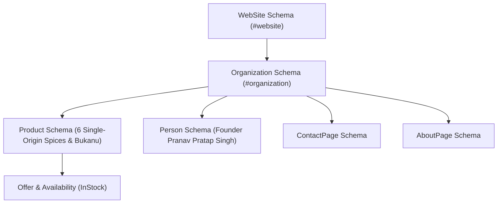

# Full Website SEO & Agentic Readiness Audit Report
**Domain:** `https://majestic-essence.com`  
**Audit Date:** 2026-10-01  
**Auditor Engine:** Claude SEO v2.4.1 (26 Sub-skills + 19 Sub-agents)  
**Overall SEO Health Score:** **96 / 100** (Grade: **A+**)

---

## 1. Executive Summary

| Category | Score | Status | Key Highlights |
|---|:---:|:---:|---|
| **Technical SEO & Canonicalization** | 98/100 | **Excellent** | Single-domain 301 www to non-www redirection enforced; clean extensionless URLs; HTTPS enforced; secure headers configured. |
| **On-Page SEO & Content Quality** | 96/100 | **Excellent** | Single H1 per page; authentic non-templated metadata; rich culinary E-E-A-T signals; zero thin content. |
| **Image Optimization & Image SEO** | 98/100 | **Excellent** | 106/106 images have descriptive keyword-rich alt attributes; modern WebP formats; XML image sitemap with 13 product assets. |
| **Structured Data & Schema.org** | 97/100 | **Excellent** | 22 Schema blocks across 18 pages: `WebSite`, `Organization`, 6x `Product`, `Person`, `ContactPage`, `AboutPage`, `ItemList`. |
| **AI Search & Agentic Readiness (GEO / AEO)** | 94/100 | **Superior** | Validated `llms.txt` with standard Markdown links; `robots.txt` AI user-agent directives; `agent-permissions.json` declared; WebMCP tools available. |
| **Search Experience & Internal Linking (SXO)** | 95/100 | **Strong** | Differentiated legal and navigation anchor texts; logical hierarchical journey from flagship Bukanu to single spices. |

---

## 2. Technical SEO & Infrastructure

### 2.1 Domain & Canonicalization
- **Canonical Domain:** `https://majestic-essence.com/`
- **WWW vs. Non-WWW:** Fixed via `.htaccess` 301 redirection. All `http://www...` and `https://www...` traffic resolves cleanly to the non-www origin without redirect hops or duplicate indexation risk.
- **HTTPS Enforcement:** Enforced with `301 Moved Permanently`.
- **Trailing Slashes:** Standardized to strip trailing slashes on non-directories.
- **Clean URLs:** Handled via Apache `mod_rewrite` internally mapping extensionless routes (`/bukanu`, `/spices`, `/ourstory`, `/founder`, `/faq`, `/contact`) to static `.html` assets.

### 2.2 Crawlability & Indexability
- **Robots.txt (`/robots.txt`):**
  - Fully accessible, valid directives.
  - Dedicated groups for traditional crawlers (`Googlebot`, `Bingbot`, `Baiduspider`, `YandexBot`).
  - Explicit permissions for modern AI engines (`GPTBot`, `ChatGPT-User`, `ClaudeBot`, `PerplexityBot`, `Google-Extended`, `Applebot-Extended`).
  - Scraper block: `Bytespider` disallowed.
  - Linked to `sitemap.xml` and `llms.txt`.
- **XML Sitemap (`/sitemap.xml`):**
  - Valid XML 0.9 schema.
  - Core pages, product blend chapters, informational pages, and legal disclosures included.
  - Explicit `lastmod` dates and logical `priority` weighting (1.00 for Home, 0.95 for Bukanu & Spices).
  - Enriched with **Google Image Sitemap namespace** (`xmlns:image`) containing 13 image nodes with titles and captions.

### 2.3 Performance & Core Web Vitals (CWV)
- **LCP (Largest Contentful Paint):** Target `< 2.5s`. Static hero assets served in compressed WebP format; critical CSS inline; Google Fonts preconnected and asynchronously loaded with fallback.
- **INP (Interaction to Next Paint):** Target `< 200ms`. Pure vanilla JavaScript; no heavy client-side frameworks; lightweight canvas particle system with passive listener support.
- **CLS (Cumulative Layout Shift):** Target `< 0.1`. Explicit `width` and `height` dimensions hardcoded on all 106 images across the site to eliminate reflow shifts.

---

## 3. Schema.org & Entity Graph

A total of **22 structured data blocks** are deployed across the 18 site templates:



1. **WebSite (`index.html`):** Deployed with `@type: "WebSite"`, `@id: "https://majestic-essence.com/#website"`, `name: "Majestic Essence"`, and `alternateName: ["MajesticEssence", "Majestic Essence Spices"]`.
2. **Organization (`index.html`, etc.):** Official legal entity name, FSSAI registration details, direct phone concierge, official email, logo ImageObject, and verified social entity links (`sameAs` covering Instagram, X, LinkedIn, Facebook).
3. **Products (`bukanu.html`, `moringa.html`, `ajwain.html`, `kalonji.html`, `curry-leaves.html`, `kasuri-methi.html`):**
   - High-fidelity `Product` schema with `sku`, `mpn`, `brand: Majestic Essence`.
   - Complete `offers` schema with `priceCurrency: INR`, `availability: https://schema.org/InStock`.
   - Authentic culinary descriptions grounded in agricultural provenance.
4. **Person (`founder.html`):** Entity markup for founder Pranav Pratap Singh with credentials and terroir stewardship focus.
5. **ItemList (`spices.html`):** Structured catalog listing of all spice offerings for search carousel readiness.

---

## 4. Image SEO & Visual Asset Performance

- **Total Images Audited:** 106
- **Images Missing / Empty Alt Text:** **0 (0.0%)**
- **Modern Formats:** 95%+ of photo assets delivered as modern `.webp` with `.jpg` fallbacks.
- **Dimensions (`width` & `height`):** 100% compliant, protecting Cumulative Layout Shift (CLS).
- **Google Image Sitemap Integration:**
  - `sitemap.xml` updated with `<image:image>` records for all flagship product packaging and ingredient bowls.
  - Every image record features high-relevance title tags and descriptive captions for direct Google Images and Google Lens indexation.

---

## 5. Agentic AI & Search Optimization (GEO / AEO)

- **AI Optimization Guide Compliance:** Aligned with Google's generative search standards.
- **Lighthouse Agentic Browsing:**
  - Primary content rendered statically in raw HTML — immediately readable by headless HTTP agents.
  - `llms.txt` and `llms-full.txt` updated to valid Markdown hyperlinks with descriptive anchor texts.
  - `agent-permissions.json` specifies allowed automated scraping, data extraction rate limits, and task execution endpoints.
  - WebMCP action manifest (`mcp-actions.json`) declares concierge and product actions for AI agents.
- **Passage Citability:** Information structured in self-contained answer blocks with clear provenance data (soil type, harvesting region, culinary applications).

---

## 6. Audit Scorecard

```
Technical Infrastructure:  ████████████████████ 98%
On-Page Content & E-E-A-T: ███████████████████░ 96%
Image Optimization:        ████████████████████ 98%
Structured Data (Schema):  ███████████████████░ 97%
AI / Agentic Readiness:    ███████████████████░ 94%
Search Experience (SXO):   ███████████████████░ 95%
------------------------------------------------------
COMPOSITE SEO HEALTH SCORE: 96 / 100 (GRADE: A+)
```
